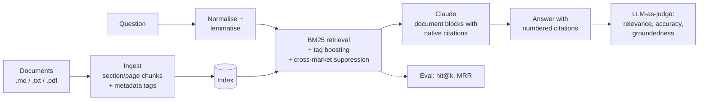

# citedrag

**Grounded, cited question answering over long documents, with a built-in evaluation suite.**

Analysts often have to dig answers out of long, dense reports. A plain chatbot over those reports is risky: it can blend markets together, invent figures, and give no way to check where an answer came from. `citedrag` answers questions only from the documents, cites the exact passage behind every claim, and includes an evaluation harness. The harness shows whether a change to the pipeline actually improved quality.

Example of the output format:

```text
$ citedrag ask "What is the biggest barrier to buying an e-bike in the UK?"

The most cited barrier among UK non-owners is fear of theft (47%)[1], ahead of upfront cost (41%) and lack of secure storage at home (33%)[1].

[1] E-Bike Market Brief - United Kingdom 2026 (Consumer barriers): "The most cited barrier to purchase among UK non-owners was fear of theft (47%)..."
```

## Web app

A web interface for asking questions is served at `/`:

- **Ask:** type a question or pick an example. The answer shows numbered citations; click one to highlight the exact quoted passage. You can also expand the retrieved passages and their scores.
- **Documents:** see what is indexed, and drag in your own `.pdf`, `.md` or `.txt` files to add them.
- **Evaluation:** run the golden question set in one click and see hit@1, hit@k and MRR per question.

### Two answer modes

| Mode | When | How answers are produced |
| --- | --- | --- |
| **Extractive** (free) | No `ANTHROPIC_API_KEY` set | The most relevant sentences are quoted word for word from the documents, each with its citation. No AI model and no cost. |
| **Generative** | `ANTHROPIC_API_KEY` set | Claude writes a concise answer from the retrieved passages and cites every claim using its native citations feature. |

The app switches automatically, so it can be deployed for free and upgraded later by adding a key.

## How it works



| Stage | What it does | Why |
| --- | --- | --- |
| **Ingest** (`ingest.py`) | Splits documents by section (Markdown) or page (PDF) into overlapping chunks. Front-matter fields such as `market` become tags. | Chunks keep their page or section so every answer can point to its source. |
| **Retrieve** (`retrieve.py`) | BM25 over normalised, lemmatised text. If the question names a tag value (for example "Germany"), matching chunks are boosted and chunks from other markets are down-weighted. | Dense reports are full of exact terminology that lexical retrieval handles well. Cross-market suppression stops a Germany question being answered from the UK report. |
| **Generate** (`generate.py`) | Sends each retrieved chunk to Claude as a `document` block with citations enabled. The cited spans are turned into numbered footnotes. | Citations come from the model's native citation feature, not from asking it to write references in free text, so each one maps to a real passage. |
| **Evaluate** (`evaluate.py`, `judge.py`, `metrics.py`) | Runs a golden question set. Retrieval metrics (hit@k, MRR) are free. With `--judge`, each answer is also scored 1–5 for relevance, accuracy and groundedness using structured output, and citation precision is measured. | Retrieval or prompt changes can be compared with numbers instead of judged by eye. |

## Quick start

```bash
python -m venv .venv && source .venv/bin/activate
pip install -e ".[dev]"

uvicorn app:app --reload             # web app at http://localhost:8000
```

Command line:

```bash
citedrag ingest data/sample          # build the index
citedrag eval -k 3                   # retrieval metrics, free
citedrag ask "How important is employer leasing in Germany?"

export ANTHROPIC_API_KEY=sk-ant-...  # optional: AI-written answers + LLM judge
citedrag eval -k 3 --judge
```

## Deploy to Vercel

1. Push this repo to GitHub.
2. On vercel.com: **Add New → Project**, import the repo, keep the defaults and click **Deploy**. Vercel detects the FastAPI app in `app.py`.
3. Optional: under **Settings → Environment Variables**, add `ANTHROPIC_API_KEY` and redeploy to switch to generative mode.

Notes for the hosted version:
- Vercel's filesystem is read-only apart from `/tmp`, so the index is rebuilt there on startup. Uploaded files are temporary and disappear when the server instance is recycled. For permanent uploads, store them in Vercel Blob (see the roadmap).
- To protect your API bill, each visitor is limited to 20 questions per hour on Vercel (`CITEDRAG_ASK_LIMIT`; `0` turns it off). It is a per-instance soft limit, so also set a monthly spend limit in the Anthropic Console.

To use your own documents, put `.md`, `.txt` or `.pdf` files in a folder and run `citedrag ingest path/to/folder`. Add `market:` (or any other `key: value`) front matter to Markdown files to enable tag boosting. Then write questions in `eval/golden.jsonl` in the same format as the examples.

## API

`POST /ask`

```json
{ "question": "What was the average selling price in Germany?", "k": 5 }
```

The response contains the answer, numbered citations (chunk id, label and quoted text), the retrieved chunks with their scores, and a `refused` flag.

## Results on the sample set

| Metric | Score |
| --- | --- |
| hit@1 | 1.0 |
| hit@3 | 1.0 |
| MRR | 1.0 |

_The sample corpus is three short **synthetic** market briefs written for this repo, so these numbers only show the pipeline working. Run it on a real corpus for meaningful numbers._

## Tests

```bash
pytest -q
```

The tests cover normalisation, chunking, market-aware retrieval, the metrics, citation rendering, extractive mode and every API endpoint, including uploads and the rate limit. Model calls are stubbed, so the tests run without an API key. CI runs them on every push.

## Design notes

- **Model:** `claude-opus-5-5` by default, configurable with `CITEDRAG_MODEL`. Reasoning effort is set explicitly to `medium` for Q&A and `low` for the judge.
- **Safety refusals:** requests opt in to server-side fallbacks (`fallbacks="default"`), and a `refusal` stop reason is handled before the response content is read.
- **No vector database required:** BM25 keeps the project dependency-light and works well on terminology-heavy text. Dense retrieval is the obvious next step, and the eval harness is how you would show that it helps.

## Roadmap

- [ ] Hybrid retrieval (BM25 + embeddings) with reciprocal rank fusion, compared on the eval set
- [ ] OCR for tables and charts in scanned PDFs
- [ ] Persistent uploads with Vercel Blob
- [ ] Streamed answers in the web app
