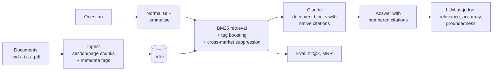

# citedrag

**Grounded, cited question answering over long documents, with a built-in evaluation suite.**

Analysts often have to dig answers out of long, dense reports. A plain chatbot over those reports is risky: it can blend markets together, invent figures, and give no way to check where an answer came from. `citedrag` answers questions only from the documents, cites the exact passage behind every claim, and includes an evaluation harness. The harness shows whether a change to the pipeline actually improved quality. A mini public version of RAG tool I built at work: ask questions about long reports and get answers that cite the exact passage they came from, plus an evaluation suite to check retrieval quality.

## What citedrag does?

citedrag answers questions about documents and shows where every answer came from.

1. You upload documents (PDF, Markdown or text) or use the three sample market reports.
2. You ask a question in plain English, e.g. “What’s the biggest barrier to buying an e-bike in the UK?”
3. It finds the most relevant passages and gives you an answer with numbered citations. Click a number to see the exact sentence it came from.
4. The “How accurate is it?” page measures how well the search finds the right document, using test questions with known answers. You can also write test questions for your own documents.


**How accurate is it?**
- Explains in plain language what is being measured. Ten test questions, each with a known source report, are run through the same search the Ask page uses.
- Shows how often the right report was ranked first, how often it was in the top 3, and the mean reciprocal rank (MRR), plus a question-by-question table.

### Two answer modes

| Mode | When | How answers are produced |
| --- | --- | --- |
| **Extractive** (free) | No `ANTHROPIC_API_KEY` set | The most relevant sentences are quoted word for word from the documents, each with its citation. No AI model and no cost. |
| **Generative** | `ANTHROPIC_API_KEY` set | Claude writes a concise answer from the retrieved passages and cites every claim using its native citations feature. |

The app switches automatically, so it can be deployed for free and upgraded later by adding a key.

## How it works



| Stage | What it does | Why |
| --- | --- | --- |
| **Ingest** (`ingest.py`) | Splits documents by section (Markdown) or page (PDF) into overlapping chunks. Front-matter fields such as `market` become tags. | Chunks keep their page or section so every answer can point to its source. |
| **Retrieve** (`retrieve.py`) | BM25 over normalised, lemmatised text. If the question names a tag value (for example "Germany"), matching chunks are boosted and chunks from other markets are down-weighted. | Dense reports are full of exact terminology that lexical retrieval handles well. Cross-market suppression stops a Germany question being answered from the UK report. |
| **Generate** (`generate.py`) | Sends each retrieved chunk to Claude as a `document` block with citations enabled. The cited spans are turned into numbered footnotes. | Citations come from the model's native citation feature, not from asking it to write references in free text, so each one maps to a real passage. |
| **Evaluate** (`evaluate.py`, `judge.py`, `metrics.py`) | Runs a golden question set. Retrieval metrics (hit@k, MRR) are free. With `--judge`, each answer is also scored 1–5 for relevance, accuracy and groundedness using structured output, and citation precision is measured. | Retrieval or prompt changes can be compared with numbers instead of judged by eye. |

## Quick start

```bash
python -m venv .venv && source .venv/bin/activate
pip install -e ".[dev]"

uvicorn app:app --reload             # web app at http://localhost:8000
```

Command line:

```bash
citedrag ingest data/sample          # build the index
citedrag eval -k 3                   # retrieval metrics, free
citedrag ask "How important is employer leasing in Germany?"

export ANTHROPIC_API_KEY=sk-ant-...  # optional: AI-written answers + LLM judge
citedrag eval -k 3 --judge
```

Notes for the hosted version:
- Vercel's filesystem is read-only apart from `/tmp`, so the sample index is rebuilt there on startup.
- Uploaded documents are kept in each visitor's browser, not on the server. They stay private to that visitor and work fine on serverless hosting. Files are limited to 4 MB each because Vercel caps request bodies at 4.5 MB.
- To use your own documents, put `.md`, `.txt` or `.pdf` files in a folder and run `citedrag ingest path/to/folder`. Add `market:` (or any other `key: value`) front matter to Markdown files to enable tag boosting. Then write questions in `eval/golden.jsonl` in the same format as the examples.

## API

| Endpoint | What it does |
| --- | --- |
| `GET /documents` | Lists the built-in sample documents. |
| `POST /parse` | Takes uploaded files (multipart) and returns their chunks. Nothing is stored on the server. |
| `POST /ask` | Answers a question. Body: `question`, optional `k`, optional `doc_ids` (which documents to search) and optional `user_chunks` (chunks returned by `/parse`). |
| `GET /examples` | Sample questions for the sample documents. |
| `GET /eval` | Retrieval metrics on the golden question set, with no model calls. |
| `GET /config` | Current answer mode (extractive or generative) and the upload size limit. |

```json
{
  "question": "What was the average selling price in Germany?",
  "k": 5,
  "doc_ids": ["ebike_germany_2026"]
}
```

The `/ask` response contains the answer, numbered citations (chunk id, label and quoted text), the retrieved passages with their scores, the answer mode, and a `refused` flag.

## Results on the sample set

| Metric | Score |
| --- | --- |
| hit@1 | 1.0 |
| hit@3 | 1.0 |
| MRR | 1.0 |

## Tests

```bash
pytest -q
```

The tests cover normalisation, chunking, market-aware retrieval, the metrics, citation rendering, extractive mode and every API endpoint, including parsing uploaded files, asking about your own documents, document filtering and the rate limit. Model calls are stubbed, so the tests run without an API key. CI runs them on every push.
